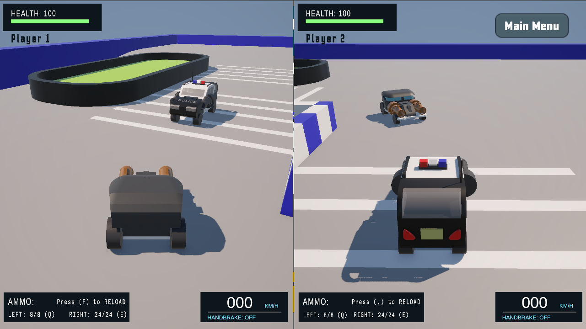
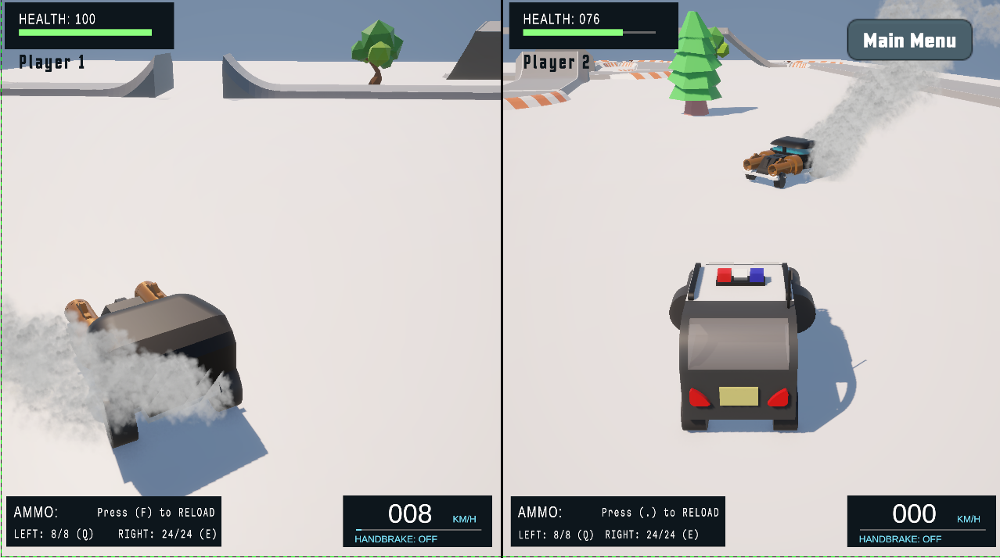
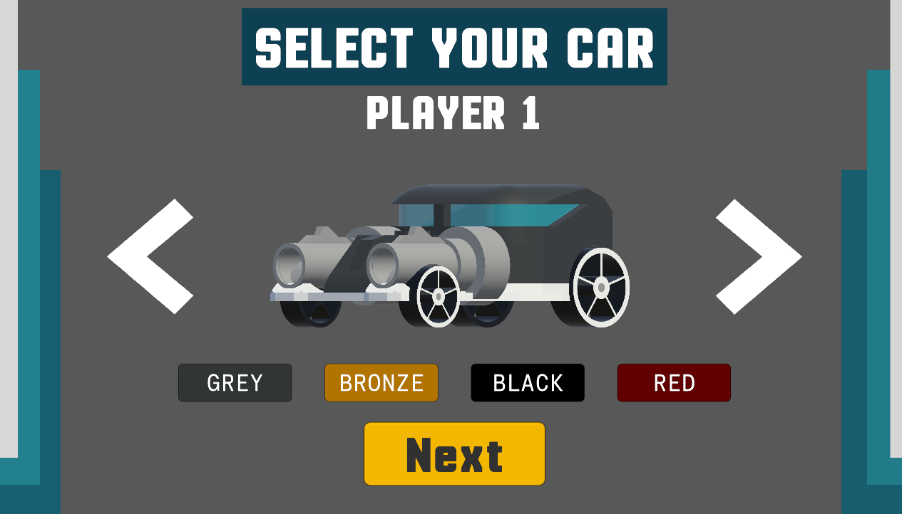

# SmashCars

**Demolition Derby** meets **Battle Royale**!!

Drive cars in an arena, use your weapons, or ram other cars, and try to be the last car standing to win!!

There are **3 different tracks** (all made by us from scratch!), and you randomly spawn in one each time!

All 3d models are made by us!!

With **split-screen 2-player local multiplayer**!!

**Play at: https://irtaza.itch.io/smashcars**

## Gameplay

## Demo Images

## Controls

### Player 1

- **W/A/S/D** to drive.
- **S** to brake or reverse.
- **Left shift** for electronic brake. (Can also be used to drift!!)
- **Q** to shoot with left weapon.
- **E** to shoot with right weapon.
- **F** to reload.

### Player 2

- **Arrow keys** to drive.
- **Down arrow key** to brake or reverse.
- **Right Control** for electronic brake. (Can also be used to drift!!)
- **/ (Slash)** to shoot with left weapon.
- **Right Shift** to shoot with right weapon.
- **. (Period)** to reload.

## Credits

Made by **[Irtaza](https://github.com/Irtaza2009)** and **[Aayan](https://github.com/MuhammadAayanMirza)**!

Our submission for **Thirdspace** week 5, week 6 and week 7!
